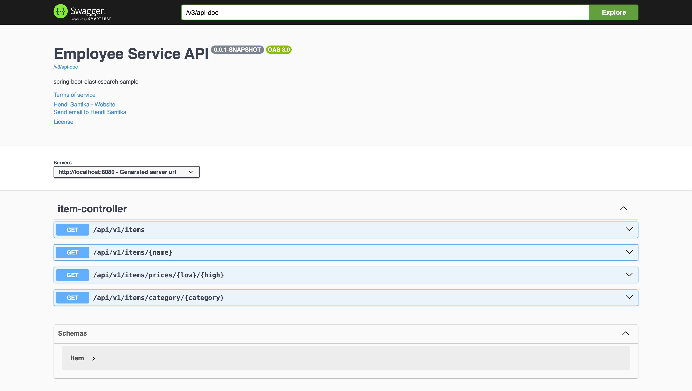

# spring-boot-elasticsearch-sample

[](https://github.com/hendisantika/spring-boot-elasticsearch-sample/actions/workflows/maven.yml)


Sample REST API built with Spring Boot and Spring Data Elasticsearch. On startup the application loads
sample items from `src/main/resources/items.csv` into the `item` index and exposes search endpoints,
documented with Swagger UI (springdoc-openapi).

## Tech Stack

| Component                | Version |
|--------------------------|---------|
| Java (JDK)               | 25      |
| Spring Boot              | 4.1.2   |
| Spring Data Elasticsearch| (managed by Spring Boot) |
| Elasticsearch            | 9.5.5   |
| springdoc-openapi        | 3.2.0   |
| OpenCSV                  | 5.12.0  |
| Testcontainers           | (managed by Spring Boot) |
| Maven Wrapper            | 3.10.0  |

## Prerequisites

- JDK 25 (e.g. [Eclipse Temurin](https://adoptium.net/))
- Docker (used by Spring Boot Docker Compose support at runtime and Testcontainers in tests)

## Getting Started

1. Clone this repository:
   ```shell
   git clone https://github.com/hendisantika/spring-boot-elasticsearch-sample.git
   ```
2. Navigate to the folder:
   ```shell
   cd spring-boot-elasticsearch-sample
   ```
3. Run the application:
   ```shell
   ./mvnw clean spring-boot:run
   ```
   Thanks to `spring-boot-docker-compose`, the Elasticsearch container defined in [`compose.yml`](compose.yml)
   is started automatically. You can also start it manually with `docker compose up -d`.
4. Open your favorite browser: http://localhost:8080/swagger-ui

## API Endpoints

Base path: `/api/v1/items`

| Method | Endpoint                          | Description                                  |
|--------|-----------------------------------|----------------------------------------------|
| GET    | `/api/v1/items`                   | List items (first page, 10 items)            |
| GET    | `/api/v1/items/{name}`            | Find items by name                           |
| GET    | `/api/v1/items/category/{category}` | Find items by category                     |
| GET    | `/api/v1/items/prices/{low}/{high}` | Find items with price between `low` and `high` |

Example:

```shell
curl http://localhost:8080/api/v1/items/category/Electronics
curl http://localhost:8080/api/v1/items/prices/10/20
```

OpenAPI docs are available at http://localhost:8080/v3/api-doc.

## Running Tests

```shell
./mvnw clean verify
```

The integration test starts an Elasticsearch `9.5.5` container through
[Testcontainers](https://testcontainers.com/) and wires it via `@ServiceConnection`, so Docker must be running.

## CI/CD & Dependency Updates

- **GitHub Actions** ([`maven.yml`](.github/workflows/maven.yml)): builds and tests the project on JDK 25 (Temurin)
  for every push and pull request to `main`, and submits the Maven dependency graph on `main`.
- **Dependabot** ([`dependabot.yml`](.github/dependabot.yml)): keeps Maven dependencies, GitHub Actions and the
  Elasticsearch Docker image up to date, with grouped pull requests (Spring Boot, springdoc, Testcontainers,
  Maven plugins, minor/patch updates) and labels.

## Swagger UI


